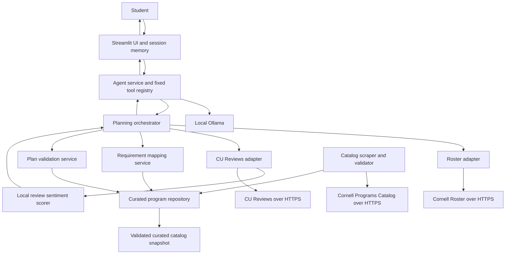

# Component Dependencies and Data Flow: Course AIdvisor

## Dependency Matrix

| Component | Depends on | Provides to |
|---|---|---|
| Streamlit UI and session state | Agent service; typed models | Agent with current message and in-memory snapshot |
| Agent and fixed tool registry | Local Ollama client; tool handlers; typed models | Streamlit with response, citations, uncertainty, findings |
| Planning orchestrator | Roster adapter; CU Reviews adapter; catalog repository; mapping; validation | Tool handlers with typed results |
| Roster adapter | httpx; fixed Cornell host; Pydantic models | Course discovery and planning |
| CU Reviews adapter | httpx; fixed CU Reviews hosts; Pydantic models | Course discovery and planning |
| Review sentiment scorer | Retrieved CU Reviews text; local scoring logic/model; typed models | Course discovery and planning |
| Catalog ingestion | httpx; fixed catalog host; parser; Pydantic; catalog index | Curated repository and coverage report |
| Curated repository | Validated public records | Requirement mapping and orchestrator (read-only) |
| Requirement mapping | Curated repository; course records; typed models | Orchestrator and fixed tools |
| Plan validation | Proposed plan; course records; curated requirements | Orchestrator and fixed tools |
| Shared domain models | Pydantic | All application components |

## Communication Pattern

- Direct Python calls with typed request/response models and explicit dependency injection.
- No message broker, separately deployed service tier, or inter-service network APIs.
- Streamlit session state is the only holder of active student profile and plan state; service calls receive snapshots and do not retain them.
- External adapters perform read-only HTTPS calls to fixed approved hosts. Ollama calls stay on localhost.

## Data Flow

Text alternative: Student messages enter Streamlit and are passed with an in-memory snapshot to the agent. The agent uses local Ollama and a fixed tool registry. Planning tools call the orchestrator, which obtains roster and review data through dedicated adapters, scores review sentiment locally, and reads curated structured catalog requirements. Separate mapping and validation services return typed, cited findings. A catalog ingestion flow scrapes the catalog's undergraduate program index and requirement pages, structures the requirement text, validates coverage and legacy remarks, and requests a straightforward human review for each re-scrape before updating the public curated snapshot. The final cited and uncertainty-aware response returns to Streamlit. Student profile and plan data do not enter ingestion or persistent catalog data.

## Trust and Data Boundaries

- Student data: Local session memory only; not persisted, logged, or sent to external sources. Only minimal lookup parameters are sent to public endpoints.
- Public source data: Course, review, and catalog data is validated and carries source URLs and retrieval timing where available.
- Review sentiment: A derived score is based on retrieved review text, includes citations and review count, and is distinct from source-provided ratings.
- Catalog integrity: Structure requirement text into program and requirement records. Compare curated program IDs with the catalog's undergraduate program table. Flag missing/duplicate entries and ambiguous data. Preserve legacy remarks as potentially transitional context for straightforward human review on every re-scrape.
- LLM boundary: The model selects among fixed tools. Pydantic validates arguments; endpoint host/path is fixed by adapters. User and review content is untrusted.
- Response boundary: Every factual course, program requirement, or rating claim includes evidence or is labeled unverified. Known plan violations cannot be described as validated.

## Deployment and Process Boundary

The Streamlit app, Python services, adapters, and repository run locally in one application process. Ollama is a local process reachable only through localhost. Approved Cornell and CU Reviews data is fetched over verified HTTPS. No cloud service, account, persistent student store, or new external service is introduced.
