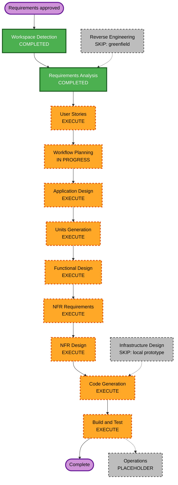

# Execution Plan: Course AIdvisor

## Detailed Analysis Summary

### Scope
- **Project type**: Greenfield; no application code exists yet.
- **Primary changes**: Build a locally run conversational academic planning assistant, including its Streamlit interface, agent orchestration, data-source tools, requirement mapping, plan validation, and test suite.
- **Affected components**: New application components only. No existing package or deployment stack requires migration.

### Change Impact Assessment
- **User-facing changes**: Yes. This creates a chat experience for student profiling, course exploration, planning, and advising handoff.
- **Structural changes**: Yes. The application needs coordinated UI, orchestration, tool, and deterministic planning components.
- **Data model changes**: Yes. Student session state, course/review records, curated program requirements, and plans need typed representations.
- **API changes**: Yes. The application will call approved public Cornell roster and CU Reviews endpoints; program requirements will be sourced from the Cornell Programs Catalog.
- **NFR impact**: High relevance. Grounding, citations, local-only student data, input validation, privacy, performance, and evaluation targets shape design and implementation.

### Risk Assessment
- **Risk level**: High. Incorrect prerequisite or requirement advice could mislead students; data sources and small local models impose uncertainty.
- **Rollback complexity**: Easy for a local prototype; changes can be reverted without production migration.
- **Testing complexity**: Complex. Requires deterministic validation and mocked integrations plus local-model scenario evaluation and manual usability/performance checks.

## Workflow Visualization

### Mermaid Diagram

### Text Alternative
1. INCEPTION: workspace detection and requirements analysis completed; reverse engineering skipped because this is greenfield. Execute User Stories, Workflow Planning, Application Design, and Units Generation.
2. CONSTRUCTION: execute Functional Design, NFR Requirements, NFR Design, Code Generation, and Build and Test. Skip Infrastructure Design because deployment is local and no infrastructure changes are required.
3. OPERATIONS: placeholder only; no deployment or monitoring stage is planned.

## Phases to Execute

### INCEPTION
- [x] Workspace Detection (completed)
- [x] Reverse Engineering (assessed and skipped: no application code)
- [x] Requirements Analysis (completed with explicit approval)
- [x] User Stories — **COMPLETED**. Personas and stories, including revised Economics major-change and ORIE graduation-preparation outcomes, explicitly approved on 2026-11-21.
- [x] Workflow Planning — **COMPLETED**. This execution plan was explicitly approved on 2026-11-21.
- [ ] Application Design — **EXECUTE**. New UI, orchestration, data access, and planning components and their contracts need definition.
- [ ] Units Generation — **EXECUTE**. Multiple modules, typed data models, tool interfaces, and plan validation warrant an explicit dependency-ordered breakdown.

### CONSTRUCTION
- [ ] Functional Design — **EXECUTE**. Requirement mapping, sequencing, conflict checks, citations, and conversational refinement contain meaningful business rules.
- [ ] NFR Requirements — **EXECUTE**. The approved requirements include concrete grounding, privacy, security, performance, coverage, and evaluation targets.
- [ ] NFR Design — **EXECUTE**. Local-only data flow, allow-listed integrations, validation, and testing controls must be reflected in the component design.
- [ ] Infrastructure Design — **SKIP**. The prototype runs as local processes and has no cloud, container, or deployment infrastructure to design.
- [ ] Code Generation — **EXECUTE (always)**. Required to implement the approved product scope.
- [ ] Build and Test — **EXECUTE (always)**. Required to document and perform build and verification activities after implementation.

### OPERATIONS
- [ ] Operations — **PLACEHOLDER**. Deployment and monitoring workflow is not available in this AI-DLC version; cloud deployment is outside MVP scope.

## Extension Applicability

- **Security Baseline**: Enabled at limited prototype-standard scope. Apply relevant controls in design and construction, including validated inputs, fixed endpoint allow-lists, safe handling of untrusted review text, local data handling, and tests for prompt injection and secret exposure.
- **Resiliency Baseline**: Disabled by the team; not applicable and not loaded.
- **Property-Based Testing**: Partially enabled. Use selectively where example-based tests are difficult to create; ask the team when test style is uncertain. Apply configured PBT rules only where relevant.

## Estimated Timeline

- **Target completion date**: December 16, 2026.
- **Available effort**: Approximately 5 team hours per week.
- **Planning window**: November 21 through December 16, 2026 (about 3.5 weeks, or approximately 17.5 team hours).
- **Total planned stages**: 12 active stages, including always-execute Code Generation and Build and Test; Operations remains a placeholder.
- **Schedule assumption**: This is a compressed estimate based on roughly 17.5 available team hours. It assumes prompt decisions at approval gates and a tightly scoped MVP; substantial local-model evaluation or integration issues may require reducing scope or revising the date.

## Success Criteria

- **Primary goal**: Deliver a locally run student advising prototype grounded in approved public and curated data sources.
- **Key deliverables**: Approved user stories and design artifacts; dependency-ordered units; working local chat, source tools, requirement mapping, and plan validation; build and test instructions and results.
- **Quality gates**: Meet or evaluate the approved grounding, plan validity, citation, tool-use, responsiveness, usability, local-data, test coverage, security, and LLM scenario targets. Disclose limitations and hand off unsupported decisions to Cornell advising.
